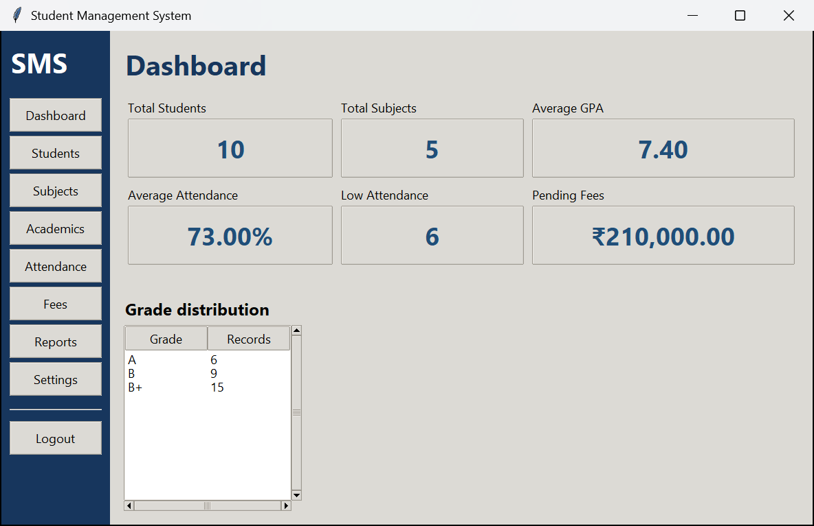
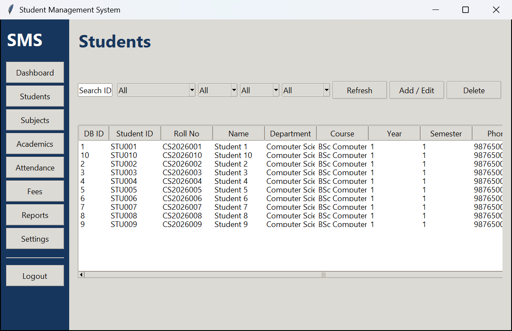
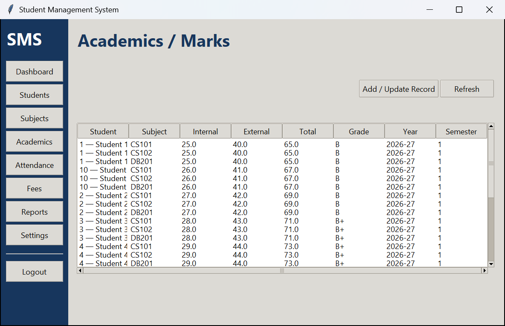
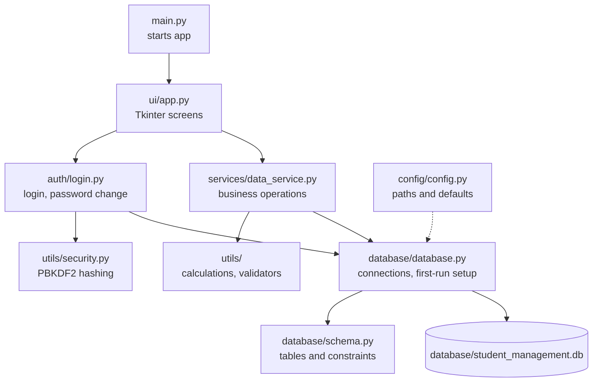
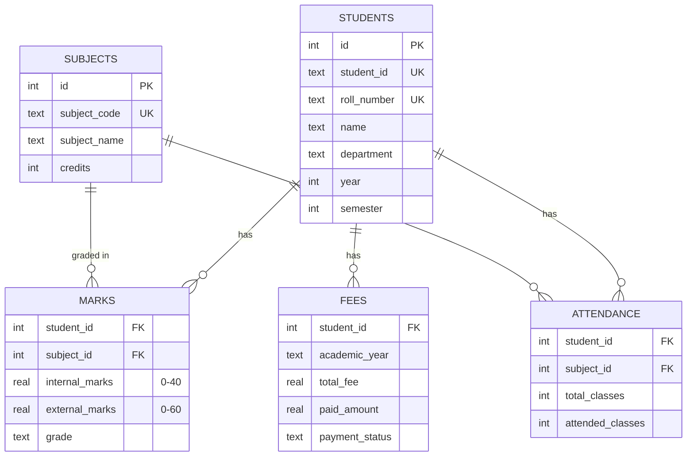

# Student Management System

[](https://github.com/iwan-adler/Student_management_system/actions/workflows/tests.yml)

A desktop app for managing student records (profiles, subjects, marks, grades, attendance and fees) built with **Python, Tkinter and SQLite**. It uses only the Python standard library: no `pip install`, no server, no internet connection.

## Why

Small departments, coaching centres and student clubs often keep academic records in scattered spreadsheets. That makes it easy to enter an impossible mark, lose track of pending fees, or miss students whose attendance is below the required minimum. This app keeps everything in one validated database and calculates grades, GPA, attendance percentages and fee status automatically.

**Who it's for:** a single administrator, such as a class coordinator or office staff member, managing records on one computer.

## Screenshots

Captured from the running app with the built-in sample data (**Settings → Initialize sample data**).



<table>
  <tr>
    <td></td>
    <td></td>
  </tr>
  <tr>
    <td align="center">Students: search, filters, sortable table</td>
    <td align="center">Academics: grades calculated from internal + external marks</td>
  </tr>
</table>

## Features

**Login and security**
- Administrator login with salted **PBKDF2-HMAC-SHA256** password hashing (100,000 iterations)
- The default password must be changed at first login (minimum 6 characters)

**Students**
- Add, edit and delete students: ID, roll number, name, date of birth, gender, contact details, department, course, year, semester and admission date
- Search by ID, roll number, name, department or course; filter by department, year, semester or gender
- Sortable table columns; delete asks for confirmation
- Student ID and roll number must be unique; email, phone and date formats are validated

**Subjects**
- Add, edit, search and delete subjects with code, name, department, semester and credits
- A subject that still has marks or attendance records **can't be deleted**, which protects existing records

**Marks, grades and GPA**
- Internal marks (out of 40) plus external marks (out of 60) give a total out of 100; the grade is calculated automatically
- GPA in student reports is **credit-weighted**
- One record per student, subject, academic year and semester; saving again updates the existing record

| Total | ≥ 90 | ≥ 80 | ≥ 70 | ≥ 60 | ≥ 50 | ≥ 40 | < 40 |
|---|---|---|---|---|---|---|---|
| Grade | A+ | A | B+ | B | C | D | F |
| Points | 10 | 9 | 8 | 7 | 6 | 5 | 0 |

**Attendance**
- Classes held and attended per subject; the percentage is calculated automatically
- A configurable low-attendance threshold (default **75%**) drives the dashboard's low-attendance count

**Fees**
- Total and paid amounts per academic year; the pending amount and status (`PAID`, `PARTIALLY PAID` or `PENDING`) are calculated automatically

**Dashboard and reports**
- Dashboard with totals, averages, low-attendance count, pending fees and grade distribution
- Student profile report (academics, GPA, attendance, fees) and a top-10 performance report
- Export any report as a `.txt` file

**Settings**
- Attendance threshold
- One-click sample data: 10 students, 5 subjects, and related marks, attendance and fees (only added to an empty database)
- "Clear operational data" removes all records but keeps the administrator account (asks for confirmation first)

## Tech stack

| Technology | Why |
|---|---|
| Python 3.10+ | Standard library only, so it runs anywhere Python runs |
| Tkinter (`ttk`) | Built-in GUI toolkit with no extra installation |
| SQLite (`sqlite3`) | A single-file relational database with foreign keys, `CHECK` constraints and transactions |
| `hashlib` / `hmac` | PBKDF2 password hashing and constant-time comparison |
| `unittest` | Built-in test framework |

## Architecture

The code is split into layers, so the screens never contain SQL and the calculation rules exist in exactly one place.



| Folder | Responsibility |
|---|---|
| `main.py` | Initialises the database, applies the UI theme, opens the login window |
| `config/` | Central settings: database path, default admin, attendance threshold |
| `database/` | Schema definition and SQLite access (foreign keys enabled on every connection) |
| `auth/` | Authentication and password changes, kept separate from the UI |
| `services/` | Database-backed operations used by the screens (CRUD, dashboard, reports, sample data) |
| `utils/` | Pure helpers: grade/GPA/attendance/fee rules, input validators, password hashing |
| `ui/` | Single-window Tkinter interface with sidebar navigation |
| `tests/` | Unit tests for calculations, validators and database setup |

## Database design

`students` is the central record. A student can have many `marks`, `attendance` and `fees` records, and each mark and attendance entry belongs to one `subject`.



How the database protects the data:
- **Deleting a student** removes their marks, attendance and fees too (`ON DELETE CASCADE`).
- **Deleting a subject** that is still referenced is blocked (`ON DELETE RESTRICT`).
- **`CHECK` constraints** reject impossible values even if the UI were bypassed: marks out of range, attended classes greater than classes held, paid amount greater than the total fee.
- **`UNIQUE` constraints** prevent duplicate student IDs, roll numbers, subject codes, and duplicate records for the same student, subject and term.
- **Parameterised queries** (`?` placeholders) are used throughout, which prevents SQL injection.
- There are also `users` and `settings` tables, for the administrator account and the attendance threshold.

## Getting started

**Requirements:** Python 3.10 or newer, with Tkinter. Tkinter is included in the python.org installers for Windows and macOS. On Debian or Ubuntu, run `sudo apt install python3-tk`.

```bash
git clone https://github.com/iwan-adler/Student_management_system.git
cd Student_management_system
python main.py
```

On first run, the app creates `database/student_management.db`. It never overwrites an existing database. The database file is gitignored, so your records stay on your machine.

**First login**

| Username | Password |
|---|---|
| `admin` | `admin123` |

You'll be asked to choose a new password straight away. To explore the app quickly, open **Settings → Initialize sample data**.

## Running the tests

```bash
python -m unittest discover -s tests -v
```

The 5 tests cover:
- the grade scale and credit-weighted GPA
- attendance percentages and fee status
- email, phone and date validators
- schema creation with a hashed default admin
- foreign keys being enforced

## Limitations

- **Single administrator** with no separate roles for teachers or students.
- **Dashboard "Average GPA" is approximate.** It is calculated as average mark ÷ 10, whereas the student report uses the exact credit-weighted GPA.
- **Reports export as plain text** only, with no PDF or charts.
- **Desktop only.** There's no network or multi-user access, and only one person should use a database file at a time.
- **No automatic backups.** Copy `database/student_management.db` to back up your data.
- **Built for academic use.** The PBKDF2 iteration count (100,000) is lower than current OWASP guidance for production systems.

## Future enhancements

1. Use the credit-weighted GPA on the dashboard.
2. Separate roles and logins for administrators, teachers and students.
3. PDF reports and Matplotlib charts.
4. One-click database backup and restore.
5. A web or mobile front end. The `services/` layer could be reused behind an API without changing the schema.
